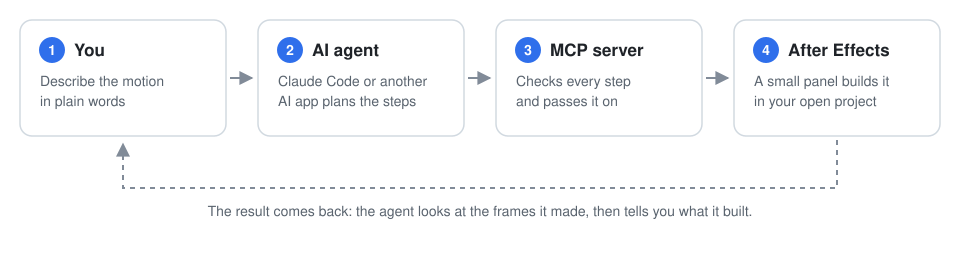
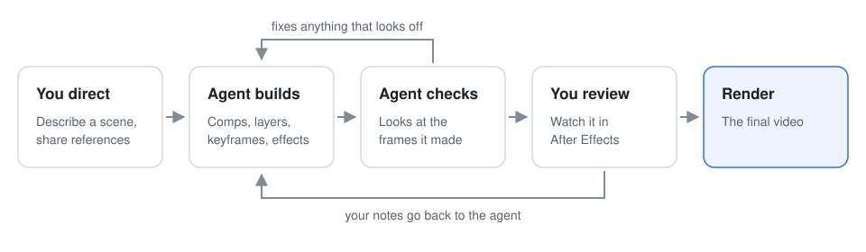
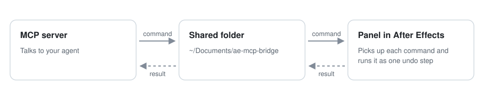
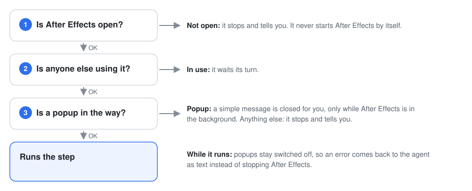

# aftereffects-mcp

A Model Context Protocol server that lets Claude Code, Claude Desktop, VS Code and any other MCP client build and edit inside a running Adobe After Effects, plus four standalone builder panels for people who prefer a button. It is for motion designers who want an agent to do the tedious parts (comps, layers, keyframes, effects, markers, renders) and for developers automating After Effects.

What sets it apart from other After Effects servers:

- Batching: many tool calls in one round-trip and one undo step (`batch`, `set-keyframes-multi`, `apply-effects-bulk`).
- Self-verification: `see-frame` and `see-frames` return PNG frames so the agent looks at its own work before reporting.
- Rig tools: the four studio rigs (edge glow, power warp transition, depth map blur reveal, blur colour reveal) as one-call tools with every parameter.
- A style file: pin house durations, easings, text styles and colours, and reference them as `@style.entrance` or `@style.h1`.
- An agent guide served by `get-help`, plus MCP prompts and resources, so an agent with 278 tools uses them well.
- A small tool list: 62 core tools are always on and the rest come in packs the agent switches on when a job needs them, so a client reads about a fifth of the definitions.
- Idempotent effects, real text animators, one easing model for every keyframe, and every command undoable in one step.
- Components: turn layers into reusable parts with a simple controls list (Essential Properties), place many copies with different text and colours, save them as templates or a library.
- Animation shortcuts built the way an animator builds them: few eased keyframes, text animators and expressions, never a key on every frame.
- A project check that flags frame-by-frame keys, loose layers, broken expressions and missing fonts or footage before anyone sees the work.
- Film building blocks: a scene plan with a master comp, transitions and element carries between scenes, UI demo moves (cursor, scroll, focus, device frames, toasts), motion rigs (counters, reflowing grids, effectors, chains, clone arrays, shape morphs) and charts from data.
- A guard for unattended runs (macOS): one driver at a time, script errors returned as text instead of alerts, stuck dialogs and stalled panels detected from outside After Effects, and nothing ever brought to the front.

## How it works

You describe what you want. The agent plans it, the server checks it, and a small panel inside After Effects builds it.

<picture>
  <source media="(prefers-color-scheme: dark)" srcset="docs/media/how-it-works-dark.svg">
  
</picture>

A typical session:

<picture>
  <source media="(prefers-color-scheme: dark)" srcset="docs/media/session-dark.svg">
  
</picture>

## Quick start

### Mac

1. Install Node.js 18 or later from https://nodejs.org and Claude Code with `npm install -g @anthropic-ai/claude-code`.
2. `git clone https://github.com/irfanabdulhameed/aftereffects-mcp.git && cd aftereffects-mcp`
3. `./setup/setup-mac.sh` (installs dependencies, builds, copies the panel into After Effects, registers the server with Claude Code)
4. In After Effects: Settings > Scripting & Expressions, tick "Allow Scripts to Write Files and Access Network", restart, then Window > mcp-bridge-auto.jsx.
5. In Claude Code: "ping After Effects". If it answers, ask for something real.

### Windows

1. Install Node.js 18 or later and Claude Code as above.
2. `git clone https://github.com/irfanabdulhameed/aftereffects-mcp.git; cd aftereffects-mcp`
3. `.\setup\setup-windows.ps1` in PowerShell.
4. In After Effects: Edit > Preferences > Scripting & Expressions, tick "Allow Scripts to Write Files and Access Network", restart, then Window > mcp-bridge-auto.jsx.
5. In Claude Code: "ping After Effects".

Manual registration for any MCP client:

```bash
claude mcp add AfterEffectsMCP node /absolute/path/to/aftereffects-mcp/server/build/index.js
```

Full details, manual steps and environment variables: [setup/README.md](setup/README.md).

## What you can ask for

- "Make a 1080p comp called Intro and add a title that fades in."
- "Add a lower third for Maya Chen, Head of Product, sliding in at 1 s and out at 5 s."
- "Put markers on the beats of the music layer and pulse the logo on every downbeat."
- "Give every selected layer a staggered fade and slide-up entrance."
- "Apply a soft shadow and a subtle vignette to the card, then show me frame 40."
- "Build the edge glow rig behind the logo in pink and purple."
- "Type on this headline at 15 characters per second with a typewriter animator."
- "Loop this clip with time remapping and add a wiggle to the camera."
- "Find every broken expression in the project and list them."
- "Make this button a component with Label and Fill controls and place three copies with different labels."
- "Type the prompt on at 20 characters per second with a blinking cursor, then press the Send button."
- "Check the comp for anything built frame by frame before I look at it."
- "Plan a 30 second film in six scenes, then match-cut from scene 2 to scene 3 and carry the logo across."
- "Build a bar chart from revenue.csv and grow Q4 to 130 at 3 seconds."
- "Read the timing from the reference comp and rebuild the lower third in our style file."

## Tool overview

The client sees 62 core tools at first: projects, comps, layers, properties, keyframes, expressions, text, shapes, effects, entrances and exits, see-frame, see-live and the project check. Every group below is also a pack. The agent calls `tool-packs` to switch packs on (the client is told the tool list changed) and `call-tool` to run a tool whose pack is off, for clients that do not reload their list. To start with more, set `AE_MCP_TOOLS` to `all` or to a comma list of packs such as `charts,ui-demo,scenes`.

| Group | Count | What is in it |
|---|---|---|
| Project | 16 | open, save, new, import, replace footage, folders, cleanup |
| Composition | 12 | create with presets, settings, work area, precompose, crop |
| Layers | 29 | list, details, create every layer type, duplicate, order, parent, flags, mattes, timing, align, sequence |
| Transform and properties | 7 | get and set any property, transform, anchor point, fit, bounds |
| Keyframes | 14 | bulk and multi writes, easing, move, copy, reverse, bake, stagger |
| Expressions | 8 | set, errors, 21 presets, expression controls |
| Text | 17 | style, fonts, 12 text animator presets, selectors, outlines, boxes, text on a path, 3D per letter, a box that grows with its text, fit text to a box |
| Shapes and icons | 14 | create, add, fill, stroke, path, modifiers, trim paths, repeater, SVG and Illustrator import as shapes, gradient fills and strokes, SVG path data, Lucide, Material Symbols and Phosphor icons by name |
| Masks | 7 | create, edit, keyframe, from shape, reveal animation |
| Effects and presets | 19 | apply (idempotent), bulk, inspect, set, keyframe, copy, 33 templates, .ffx presets |
| Camera, lights, 3D | 11 | camera settings, camera moves, camera rigs (orbit, push, crane, drift, rack focus), lights, materials, look at, Advanced 3D renderer, extrusion and bevels, environment light |
| Time | 7 | time remap, freeze, speed, reverse, blending, loop |
| Markers and audio | 10 | markers, waveform analysis, audio to keyframes, beat grids |
| Render, preview and export | 15 | see-frame, see-live (Live View plug-in), contact sheets, render queue, stills, one-step background export (mp4, ProRes, gif, webm) and phone previews |
| Rigs | 5 | the four panels as tools |
| Batch, workflow, utilities | 17 | batch, undo, status, snapshots, find, replace, relink |
| Components and templates | 11 | make a component with Essential Properties, set each copy's values, place many copies, responsive timing, .mogrt export, a component library to save parts into and insert them from (works from OneDrive or iCloud with parts downloaded on demand) |
| Animation shortcuts | 10 | move a property, entrances and exits with stagger, typewriter with cursor, word-by-word reveal, button press, move along a path, replay at markers, camera push, Smart Animate between two state comps |
| Layer styles | 4 | drop shadow, glows, bevel, satin, colour and gradient overlay, stroke |
| Project check | 4 | construction audit, clear caches, save a numbered version, sort the project into folders |
| Scenes | 6 | a scene plan with a master comp, retime, insert and remove scenes, reference overlays |
| Transitions | 4 | match cut, push, whip, zoom-through, mask reveal, carry an element across a cut |
| UI demo | 6 | cursor journey with clicks, scroll in a window, focus on a region, device frames, highlights, toasts |
| Motion rigs | 9 | number counter, grid and bento layout, proximity effector, follow chain, clone array, shape morph, wiggle, sway, fit to a box |
| Charts | 7 | bar, line and pie charts, stat with sparkline, progress bar and ring, animated data changes |
| Looks and backgrounds | 2 | glow, bloom, grain, vignette, light sweep, frosted glass, soft shadow, motion blur; looping mesh gradient, aurora, grid, dots and noise backgrounds |
| Figma | 1 | a Figma frame rebuilt as editable layers from a link or a saved JSON |
| AE guard (macOS) | 4 | status, dialogs, panel reload and re-arm |
| Help and packs | 4 | agent guide, tool list with inputs, packs on and off, run any tool |

Every tool with its inputs and an example: [docs/TOOLS.md](docs/TOOLS.md) (generated). How an agent should work with them: [docs/AGENT-GUIDE.md](docs/AGENT-GUIDE.md).

## Live View (macOS)

A small native plug-in keeps a picture of the active composition at the playhead in the bridge folder, drawn only after the comp settles, so `see-live` shows the agent what the viewer shows without running a script or a render. Build and install steps: [native/live-view/README.md](native/live-view/README.md). Without it, `see-frame` does the same job on request.

## The four builder panels

Each panel is a dockable ScriptUI panel in [panels/](panels/) with its own guide, and each also exists as a `rig-*` tool with the same logic and defaults. See [panels/README.md](panels/README.md).

**Edge Glow** ([guide](panels/edge-glow/GUIDE.md)). A rounded rectangle with a glowing four-colour gradient rim, an animated light sweep and a soft coloured halo. Tool: `rig-edge-glow`.

**Power Warp Transition** ([guide](panels/power-warp-transition/GUIDE.md)). A depth-map driven transition: gradient wipe, glowing scan line, pseudo-3D shake, CC Glass warp, chromatic aberration and fine distortions, keyframed to a time window. Tool: `rig-power-warp-transition`.

**Depth Map Blur Reveal** ([guide](panels/depth-map-blur-reveal/GUIDE.md)). An image resolves out of a depth-weighted blur with an exposure lift and a fading glow. Tool: `rig-depth-map-blur-reveal`.

**Blur Color Reveal** ([guide](panels/blur-color-reveal/GUIDE.md)). A soft two-tone colour disc blooms outward to reveal the content beneath. Tool: `rig-blur-color-reveal`.

## Under the hood

<picture>
  <source media="(prefers-color-scheme: dark)" srcset="docs/media/bridge-dark.svg">
  
</picture>

The server and the panel talk through files in a shared folder, so nothing needs a network port or a plug-in. Details: [docs/ARCHITECTURE.md](docs/ARCHITECTURE.md).

## The guard (macOS)

One popup in After Effects can stop everything until someone clicks it. The guard keeps long runs going without touching your screen:

<picture>
  <source media="(prefers-color-scheme: dark)" srcset="docs/media/guard-dark.svg">
  
</picture>

- Only one agent drives After Effects at a time (`driver.lock`).
- Closing popups is off by default. When on, it only closes plain messages, never a settings window, never while After Effects is in front, and never presses buttons like Delete, Don't Save or Quit.
- `get-ae-status` tells you what After Effects is doing: rendering, waiting in a popup, or panel closed.
- `ae-do` runs your own `.jsx` files through the same checks.

Setup, the states and the settings: [docs/ARCHITECTURE.md](docs/ARCHITECTURE.md#the-ae-guard).

## Style file

Point `AE_MCP_STYLE_FILE` at a JSON or YAML file with named durations, easings, stagger values, text styles, colours and free-text rules. The agent sees a summary in `get-help` and can write `"@style.entrance"` or `"@style.h1"` wherever an easing or text style is accepted. See [docs/style-file.example.json](docs/style-file.example.json).

## Troubleshooting

1. The panel is not in the Window menu: `npm run install-bridge`, then quit and reopen After Effects.
2. Every tool times out: tick "Allow Scripts to Write Files and Access Network" in Scripting & Expressions and reopen the panel.
3. `bridge-not-running`: the panel is closed or Auto-run is unticked. Nothing ran; call the tool again once the panel is open.
4. `timeout` on a render or big batch: it is still running; `get-results` with the id fetches it when done.
5. `versionsMatch: false` from `get-bridge-status`: `npm run build && npm run install-bridge`, reopen the panel.
6. `dialog-open` or `ae-busy`: a dialog is waiting in After Effects, or another client is driving it. `get-ae-status` says which.

Every error code and what to do: [docs/TROUBLESHOOTING.md](docs/TROUBLESHOOTING.md).

## Compatibility

- After Effects: written against the 2024 to 2026 scripting API. The file bridge, undo groups and every core tool work on 2022 and later. Features that need newer versions return a clear `unsupported` error on older ones: per-layer track mattes (23.0), the font list (24.0), `saveFrameToPng` for `see-frame` (22.3, with a render-queue fallback), dropdown control items (2023), saving presets by script.
- Tested here: After Effects 2026 (26.5) on macOS with Apple silicon, driven for long unattended runs through the bridge and `ae-do`; the Node side and the mock bridge with Node 20 to 23. `npm run smoke` checks a live After Effects, and `docs/DECISIONS.md` lists the matchNames and version behaviours not yet verified on older versions.
- Mac and Windows: paths, the panel install and the setup scripts handle both. Continuous integration runs on Ubuntu and Windows with Node 20 and 22.
- Node.js 18 or later.

## Contributing

How to add a tool, the ES3 rules and the shared API: [docs/CONTRIBUTING.md](docs/CONTRIBUTING.md). Judgement calls made during the rewrite: [docs/DECISIONS.md](docs/DECISIONS.md). Release notes: [CHANGELOG.md](CHANGELOG.md).

## License

MIT. See [LICENSE](LICENSE).
